# LoungeCat Desktop 2.0

**A native Linux IRC client, with room for every conversation.**

Connect to multiple networks, keep channels side by side, and make the workspace yours
with seven built-in themes and the original LoungeCat cat branding. Built with
**C++20 and Qt 6 Widgets**.

[Build & run](BUILD.md) · [Screenshots](#screenshots) · [Moving from v1](docs/MIGRATION-v2.md) · [Release notes](CHANGELOG.md)

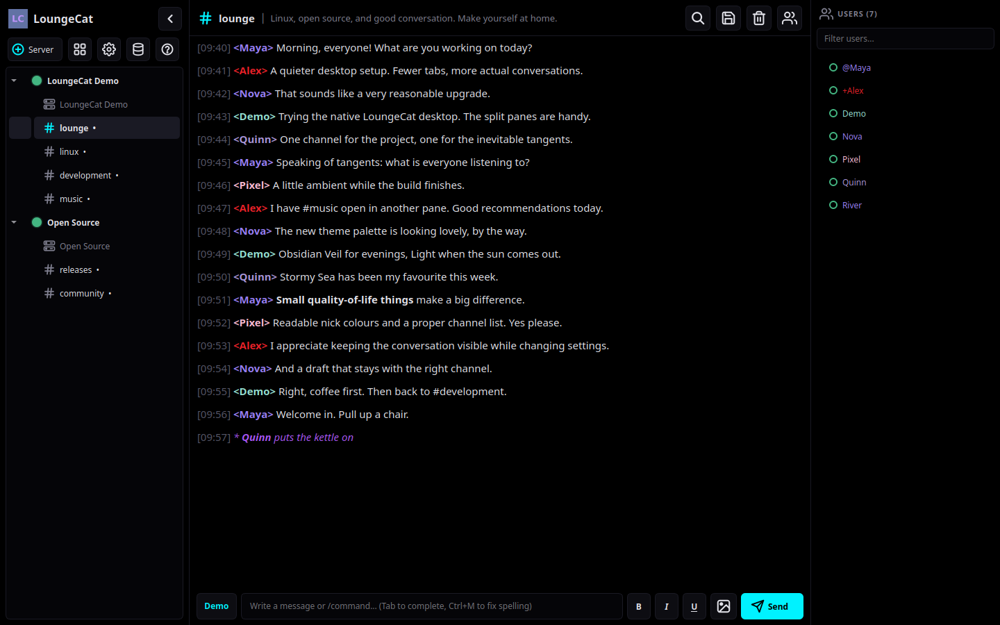

## At a glance

| Feature | What you get |
| --- | --- |
| **Your conversations, together** | Multiple IRC networks, channel and private-message lists, member rosters and local history |
| **A workspace that fits** | Single chat, horizontal/vertical split, or a four-pane grid; independent channel selectors and drafts |
| **Seven built-in themes** | Obsidian Veil, Dark, Light, High Voltage, Neon Night, Retro Warmth and Stormy Sea; custom-theme support |
| **More than plain text** | IRC formatting, nickname colours, highlights, chat search, link previews and image uploads |
| **Connection controls** | TLS verification, SASL PLAIN, NickServ, proxies, explicit reconnect state and IRCv3 support |
| **Make it yours** | Appearance, chat/logging, notifications/audio, media and spellcheck settings |

## Build & run

**Linux binary builds:** version tags that pass every CI gate are published to [GitHub Releases](https://github.com/binkiewka/LoungeCat-Desktop/releases). Successful [Linux CI runs](https://github.com/binkiewka/LoungeCat-Desktop/actions/workflows/ci.yml?query=branch%3Amaster) provide x86_64 **AppImage + `.deb`**, matching source and checksums in the `loungecat-linux-x86_64` artifact (14-day retention; GitHub login may be required). Linux is the validated target; Windows/macOS and complete v1 feature/profile parity are not certified.

With a C++20 compiler, CMake 3.24+ and Qt 6.4+ development packages installed:

```sh
cmake -S . -B build/release -DCMAKE_BUILD_TYPE=Release -DBUILD_TESTING=OFF
cmake --build build/release --parallel 2
LOUNGECAT_DATA_DIR="$HOME/.loungecat-v2-preview" ./build/release/loungecat
```

The separate preview profile keeps an existing Kotlin profile out of the first-run
path. Leave `LOUNGECAT_DB_PATH` and `LOUNGECAT_CONFIG` unset. See [BUILD.md](BUILD.md)
for Debian/Ubuntu dependencies, test commands and runtime requirements, and read the
[migration/rollback notes](docs/MIGRATION-v2.md) before reusing existing data.

**Additional packages:** Fedora 44 x86_64 RPM and a Gentoo amd64 ebuild/overlay are built and tested by their own required CI jobs. The combined `loungecat-release-linux-x86_64` artifact contains all formats and verified checksums.

**Package baseline:** Debian 12 / glibc 2.36, x86_64. CI installs/runs both formats in clean Debian 12 and Ubuntu 24.04 containers, including a virtual X11 window, Settings, SQLite, verified TLS and shutdown checks. This is not certification of every distro/compositor. The RPM targets Fedora 44, not every RPM distro; Gentoo uses system Qt and compiles from source. Flatpak, Windows and ARM64 are not built yet. See [package/download instructions](docs/PACKAGING.md).

## Screenshots

These are captures of the actual v2 Linux application with synthetic conversations
and a disposable demo profile—not UI mockups. No private chats or credentials are
shown. [Capture details](docs/screenshots/README.md).

### Themes

Obsidian Veil is shown above. The same conversation in the other six built-in themes:

| Dark | Light |
| --- | --- |
| 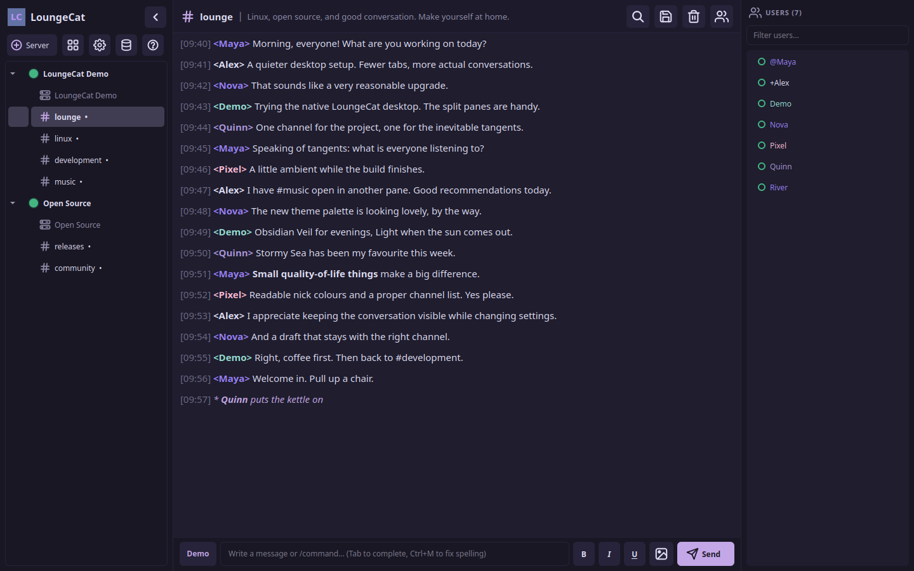 | 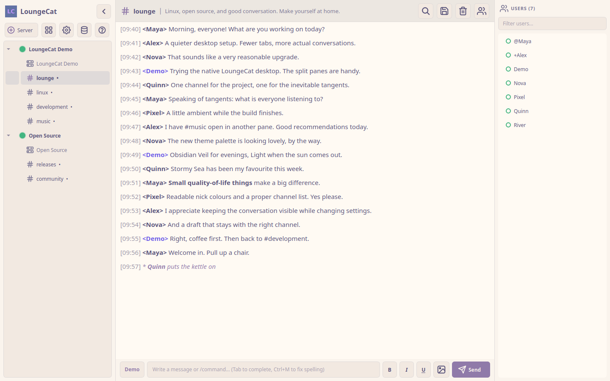 |
| **High Voltage** | **Neon Night** |
| 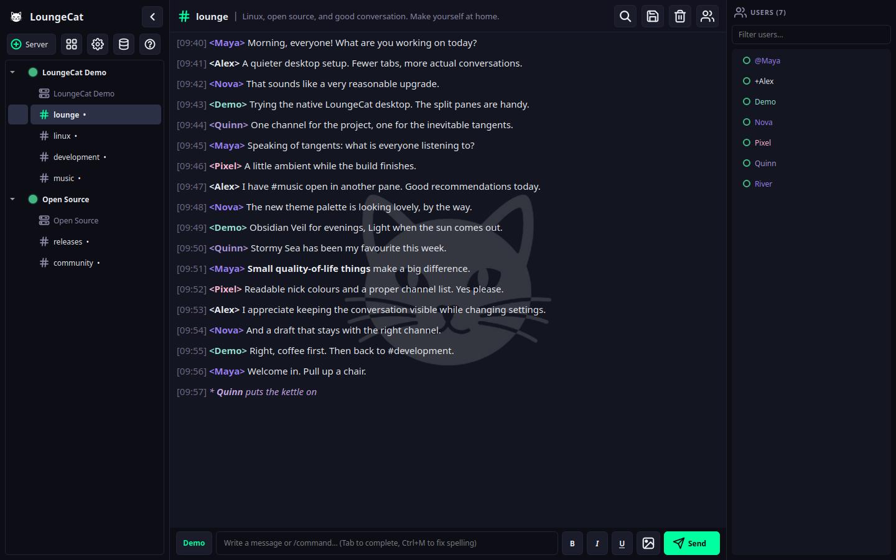 | 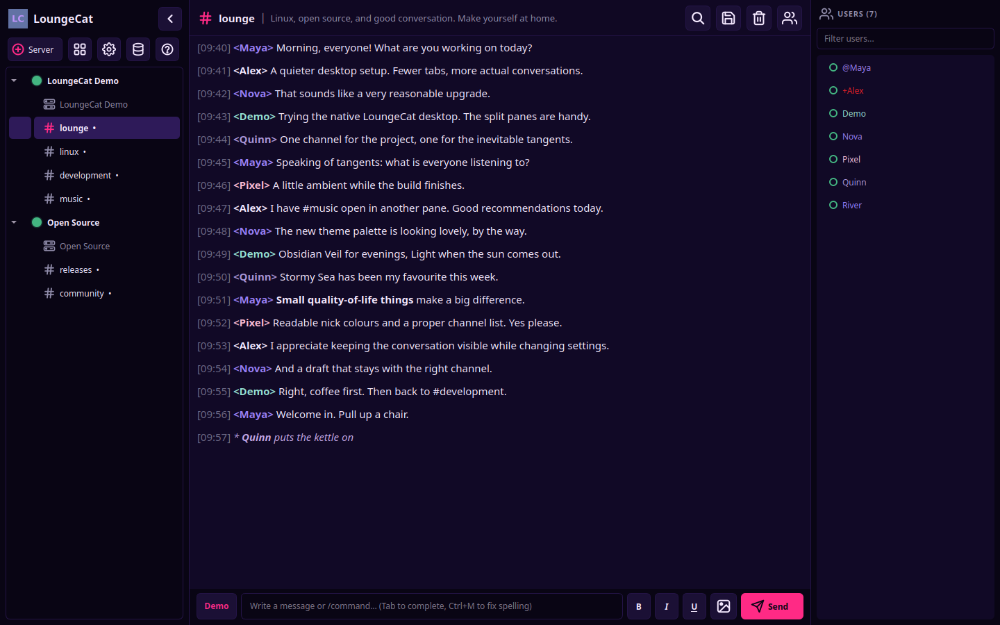 |
| **Retro Warmth** | **Stormy Sea** |
| 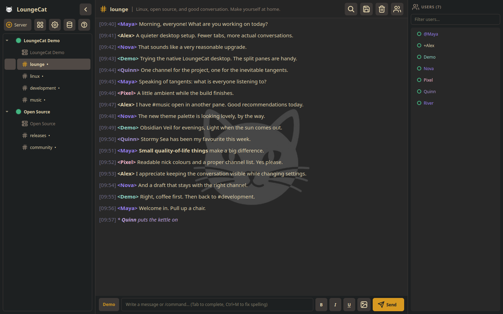 | 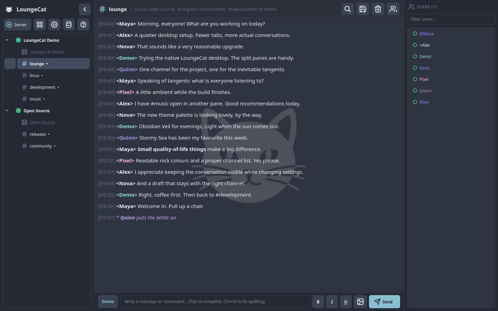 |

### Four conversations, one window

Choose a different channel in each pane without switching away from the others.

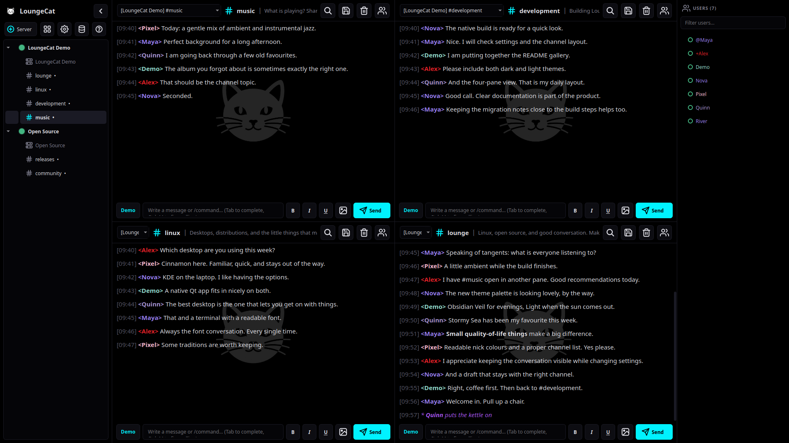

### Settings

| Appearance | Chat & Logs |
| --- | --- |
| 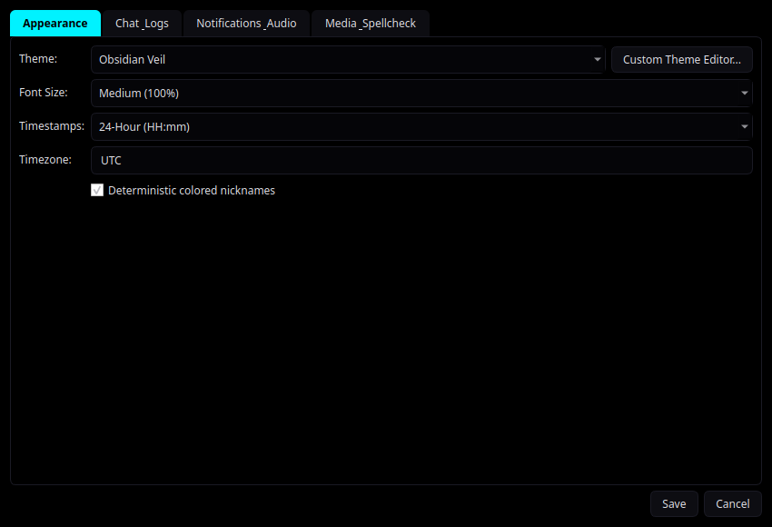 | 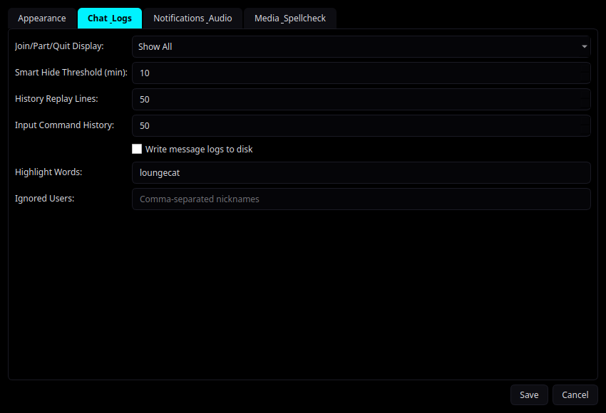 |
| **Notifications & Audio** | **Media & Spellcheck** |
| 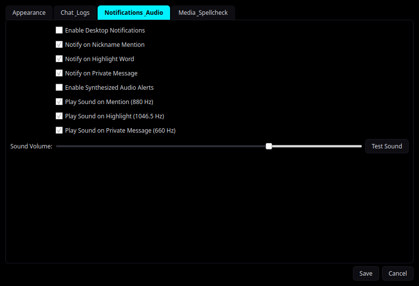 | 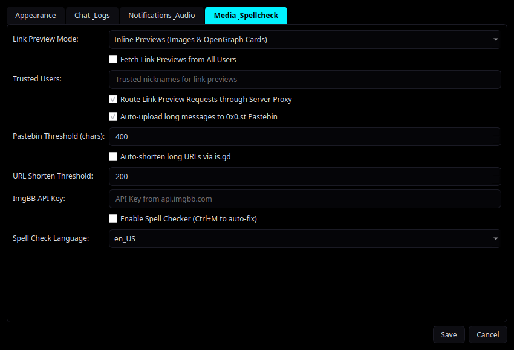 |

<details>
<summary>Server setup</summary>

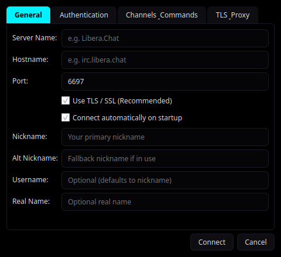

</details>

## From Kotlin v1 to native v2

This is the native successor in the existing `LoungeCat-Desktop` repository, not a
replacement repository or an Android build. Existing Kotlin releases retain their
original tags and MIT license; [`legacy/kotlin-v1`](https://github.com/binkiewka/LoungeCat-Desktop/tree/legacy/kotlin-v1)
preserves the last published Kotlin source. The native successor is GPL-3.0-or-later.

Both desktop implementations default to `~/.loungecat/` on Linux. Full v1-to-v2
profile upgrade/downgrade compatibility is **not certified**: start with a separate
preview profile and keep private backups. See [migration](docs/MIGRATION-v2.md)
and [known limitations](docs/LIMITATIONS.md).

## Connection behavior

- TLS verification is enabled by default. Saved SASL/NickServ/on-connect credentials and channel keys require TLS; invalid configuration and certificate/authentication failures pause automatic retry.
- Required **SASL PLAIN** must complete before the connection is marked ready. EXTERNAL is not offered by this configuration model because no client certificate is configured.
- NickServ-only automatic joins/commands wait for standardized account evidence, not a fixed sleep. If confirmation is unavailable within 15 seconds, the app keeps the IRC connection but withholds automation and reports the reason. Prefer SASL; otherwise identify and join manually.
- Retry intent, stable-period reset, jitter and idempotent Connect are explicit policy. One configured alternate nickname is attempted before pausing; an already-registered nick is never replaced locally merely because a nick change was rejected.
- Non-control output is bounded and paced (initial burst up to four commands, then at most one refill per 500 ms); protocol control traffic can bypass the data queue. Retirement clears queued work. Queue acceptance is not proof of server delivery.
- Nick/channel identity follows the server's CASEMAPPING through transport state, conversation lookup, sidebars, caches and draft keys. Keyed manual joins persist structured key knowledge; deliberate PART removes it.

For low join/quit churn during laptop or phone disconnection, configure a persistent IRC bouncer/core. A local socket alone cannot preserve an upstream session while its host is offline. Roster snapshots are not new joins, and cached history is not recovery of messages never received.

## Implemented stack

| Component | Actual implementation |
|---|---|
| Language/build | C++20, CMake 3.24+, Qt automatic MOC/RCC/UIC |
| UI | Qt 6 Widgets, Svg, virtualized message models/delegates |
| IRC/TLS/proxies | Custom `IrcClient` over Qt Network `QSslSocket` / `QNetworkProxy` |
| Policy/authentication | `ConnectionPolicy`, `IrcRegistration`, manager-owned generation/timer adapters |
| Persistence | Qt SQL / SQLite; Qt JSON; owner-only credential-bearing local database and secret-free portable backups |
| HTTP/previews | Qt Network; request/response validation in service adapters |
| Workers | Qt Concurrent / bounded owned thread pools |
| Sound | ALSA when available; existing synthesized notification implementation |
| Tests | **QtTest**, synthetic local TCP/TLS/HTTP fixtures; optional ASan+UBSan or TSan build modes |

No startup/RSS benchmark or complete cross-platform feature-parity certification is claimed. Runtime ownership and current repair/test boundaries are documented in [reliability notes](docs/reliability/README.md). Earlier `docs/01`–`05` files are historical conversion plans, not a list of installed alternative libraries.

## Build and test

On Debian/Ubuntu install CMake, a C++20 compiler, Qt 6 development packages for Core/Gui/Widgets/Network/Sql/Concurrent/Svg and QtTest; ALSA development headers are optional. Example:

```sh
cmake --preset debug
cmake --build --preset debug --parallel 2
ctest --preset debug
```

The three test executables use synthetic fixtures and an offscreen Qt platform. Do not point tests at a personal profile. For native ownership checks:

```sh
cmake --preset asan
cmake --build --preset asan --parallel 2
ASAN_OPTIONS=detect_leaks=1 ctest --preset asan
```

TSan has a separate preset and is not equivalent to an ASan result. The CI workflow builds normal and ASan variants; adding workflow source does not mean a hosted CI run has occurred.

## Profiles and migration

The normal profile lives under `~/.loungecat/`; `AppConfig` supports an isolated data directory for test/fixture use. Historical databases/caches are migrated or preserved, not reset. SQLite's additive `channel_keys` field stores structured rejoin keys with the same owner-only, local credential policy as existing saved passwords. Portable backups omit passwords, API keys, channel keys and saved commands, and disable auto-connect in exported profiles. Re-enter required secrets after import. Local database files still contain credentials and must be kept private. Older backups may also contain credentials. See [historical repair contracts](docs/repairs/README.md).

### Text-log identity

New text logs use `logs/v2/network-<saved-server-id>/`. Channel/query filenames have a readable bounded prefix and a digest of the IRC-casemapped target, so punctuation, Unicode names and duplicate network display names cannot mix unrelated conversations. Renaming a network keeps its saved ID and log directory.

Legacy history is retained. The new writer does not append to or merge ambiguous legacy log files; existing size/file quotas and explicit storage-error reporting still apply.

## License and dependencies

LoungeCat C++ application source is licensed under **GNU GPL version 3 or later** (`GPL-3.0-or-later`). See the full [license](LICENSE) and the application's [copyright and license grant](COPYRIGHT).

Anyone may use, study, modify and redistribute it, including commercially, under the GPL's terms. Distributed modified versions must preserve those freedoms and meet the corresponding-source obligations; private modifications do not have to be published. This keeps distributed derivatives open-source instead of permitting closed-source redistributions of modified application code.

[Third-party notices](THIRD_PARTY_NOTICES.md) describe Qt, ALSA and TLS dependency boundaries; those components retain their own licenses. No code from the GPL/AGPL comparison clients was copied into this application. The earlier Kotlin desktop source remains MIT-licensed at its original revisions; its retained notice is in [third_party/licenses/LoungeCat-Kotlin-MIT.txt](third_party/licenses/LoungeCat-Kotlin-MIT.txt). The separate Android application retains its existing MIT license.
