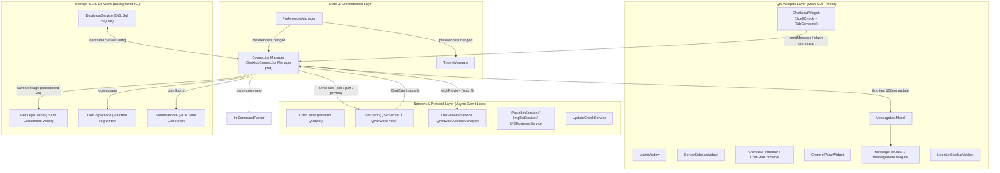

> Historical conversion plan/specification. Current implemented dependencies, connection contracts and verification are in ../README.md and reliability/README.md. Alternative libraries and old fixed-delay behavior below are not current runtime guarantees.

> Historical conversion design, not the current feature/verification contract. See [current README](../README.md) and [v2 migration notes](MIGRATION-v2.md).

# 01 — Architecture, Build System & Kotlin-to-C++ Mapping

This specification defines the CMake build system, C++20/Qt6 architecture, concurrency model, and complete 1:1 file and class mapping from [`LoungeCat-Desktop`](https://github.com/binkiewka/LoungeCat-Desktop/tree/e0c82bf8f4358be8c48cfe3d39ffc6fa1a0a55f0) (Kotlin/Compose) to [the native source tree](../src/).

---

## 1. Build System (`CMakeLists.txt` Blueprint)

The project uses **CMake 3.24+**, **C++20**, and **Qt 6** (`Core`, `Gui`, `Widgets`, `Network`, `Sql`, `Concurrent`, `Svg`, `Test`). System Hunspell (`libhunspell-dev`) is linked via `pkg-config` for spell checking, and Linux sound notifications use either native ALSA (`asound`) / PulseAudio (`pulse-simple`) or `QProcess` / `Qt6::Multimedia` if installed.

### Root `CMakeLists.txt` Reference

```cmake
cmake_minimum_required(VERSION 3.24)
project(LoungeCat VERSION 1.3.0 LANGUAGES CXX)

set(CMAKE_CXX_STANDARD 20)
set(CMAKE_CXX_STANDARD_REQUIRED ON)
set(CMAKE_CXX_EXTENSIONS OFF)

set(CMAKE_AUTOMOC ON)
set(CMAKE_AUTORCC ON)
set(CMAKE_AUTOUIC ON)

find_package(Qt6 REQUIRED COMPONENTS
    Core
    Gui
    Widgets
    Network
    Sql
    Concurrent
    Svg
    Test
)

find_package(PkgConfig REQUIRED)
pkg_check_modules(HUNSPELL QUIET IMPORTED_TARGET hunspell)
pkg_check_modules(ALSA QUIET IMPORTED_TARGET alsa)

add_compile_definitions(
    APP_VERSION="${PROJECT_VERSION}"
    QT_NO_KEYWORDS
)

# Core static library shared between the desktop executable and unit tests
add_library(loungecat_core STATIC
    src/app/AppConfig.cpp
    src/app/SingleInstanceGuard.cpp
    src/data/model/ServerConfig.cpp
    src/data/model/IncomingMessage.cpp
    src/data/model/Channel.cpp
    src/data/model/ChannelUser.cpp
    src/data/model/UserPreferences.cpp
    src/data/model/ServerConnection.cpp
    src/data/model/UrlPreview.cpp
    src/data/model/WhoisInfo.cpp
    src/data/database/DatabaseService.cpp
    src/data/cache/MessageCache.cpp
    src/data/preferences/PreferencesManager.cpp
    src/network/ChatClient.cpp
    src/network/IrcClient.cpp
    src/network/ConnectionManager.cpp
    src/service/LinkPreviewService.cpp
    src/service/PastebinService.cpp
    src/service/ImgBbService.cpp
    src/service/UrlShortenerService.cpp
    src/service/TextLogService.cpp
    src/service/SoundService.cpp
    src/service/UpdateCheckService.cpp
    src/util/PlatformUtils.cpp
    src/util/IrcCommandParser.cpp
    src/util/IrcFormatParser.cpp
    src/util/NickColorGenerator.cpp
    src/util/HighlightMatcher.cpp
    src/util/ChatGrouping.cpp
    src/util/TabCompletion.cpp
    src/util/SpellChecker.cpp
    src/util/SystemInfoCollector.cpp
    src/util/ChatExporter.cpp
    src/util/ConfigExporter.cpp
    src/ui/theme/Theme.cpp
    src/ui/theme/ThemeManager.cpp
)

target_include_directories(loungecat_core PUBLIC ${CMAKE_CURRENT_SOURCE_DIR}/src)
target_link_libraries(loungecat_core PUBLIC
    Qt6::Core
    Qt6::Gui
    Qt6::Widgets
    Qt6::Network
    Qt6::Sql
    Qt6::Concurrent
    Qt6::Svg
)

if(HUNSPELL_FOUND)
    target_compile_definitions(loungecat_core PUBLIC HAVE_HUNSPELL=1)
    target_link_libraries(loungecat_core PUBLIC PkgConfig::HUNSPELL)
endif()

if(ALSA_FOUND)
    target_compile_definitions(loungecat_core PUBLIC HAVE_ALSA=1)
    target_link_libraries(loungecat_core PUBLIC PkgConfig::ALSA)
endif()

# Main Desktop Executable
add_executable(loungecat
    src/main.cpp
    src/ui/window/MainWindow.cpp
    src/ui/sidebar/ServerSidebarWidget.cpp
    src/ui/sidebar/UserListSidebarWidget.cpp
    src/ui/chat/SplitViewContainer.cpp
    src/ui/chat/ChatGridContainer.cpp
    src/ui/chat/ChannelPaneWidget.cpp
    src/ui/chat/MessageListModel.cpp
    src/ui/chat/MessageListView.cpp
    src/ui/chat/MessageItemDelegate.cpp
    src/ui/chat/ChatInputWidget.cpp
    src/ui/chat/SearchOverlayBar.cpp
    src/ui/chat/UrlPreviewCardWidget.cpp
    src/ui/dialog/ConnectServerDialog.cpp
    src/ui/dialog/SettingsDialog.cpp
    src/ui/dialog/ModerationDialog.cpp
    src/ui/dialog/ChannelListDialog.cpp
    src/ui/dialog/ThemeEditorDialog.cpp
    src/ui/dialog/HelpDialog.cpp
    src/ui/tray/SystemTrayController.cpp
    resources/resources.qrc
)

target_link_libraries(loungecat PRIVATE loungecat_core)

# CTest Suite
enable_testing()
add_subdirectory(tests)
```

---

## 2. High-Level Architecture & Concurrency Model

### 2.1 Replacing Kotlin Coroutines & StateFlows with Qt6 Idioms

| Kotlin / Compose Mechanism | Qt 6 / C++20 Equivalent | Design Rules |
|---|---|---|
| `CoroutineScope(SupervisorJob() + Dispatchers.IO)` | Event-driven `QObject` on main thread (`QSslSocket`, `QNetworkAccessManager`) + `QtConcurrent::run` / dedicated `QThread` for disk I/O | `QSslSocket` and `QNetworkAccessManager` are already non-blocking asynchronous state machines on the Qt event loop; no per-socket blocking threads are needed. |
| `MutableStateFlow<T>` / `StateFlow<T>` | `QObject` properties + `Q_SIGNALS` + throttled `QTimer` (100 ms UI batching) | State mutations emit signals (`connectionsChanged()`, `channelMessagesUpdated(qint64 serverId, QString channelName)`). |
| `SharedFlow<ChatEvent>` (buffer = 64) | `ChatClient` Qt signals (`Q_SIGNALS`) connected via `Qt::QueuedConnection` or `Qt::AutoConnection` | Every `ChatEvent` sealed subclass becomes a strongly-typed signal on `ChatClient` (or a `std::variant<...>` event payload emitted via `eventReceived(ChatEvent)`). |
| `Mutex` (`kotlinx.coroutines.sync.Mutex`) | Explicit owner-thread confinement and immutable worker snapshots | SQLite operations stay on their creating GUI thread; a mutex does not make a Qt SQL connection transferable. Text logs use an owned single-worker pool. Settings and dictionaries expose synchronized value snapshots. See [repair contracts](repairs/README.md). |
| `Semaphore(3)` (URL previews) | Queue in `LinkPreviewService` with `m_activeRequests < 3` counter | Limits concurrent HTTP `GET` requests for link previews to 3. |
| Compose `LazyColumn` + `SelectionContainer` | `QListView` + `QAbstractListModel` (`MessageListModel`) + custom `QStyledItemDelegate` (`MessageItemDelegate`) | Virtualized rendering with `QTextDocument` layout caching per row width, supporting multi-message text selection and rich click targets (URLs, nicknames, image collapse/expand). |

### 2.2 Component Data Flow Diagram



---

## 3. Complete 1:1 File & Class Mapping

Every file in the Kotlin `shared/src/` tree maps to a dedicated header/implementation pair in the native `src/` tree.

### 3.1 Application Entry & Lifecycle

| Kotlin Source File | C++ Target Files | Key Responsibilities |
|---|---|---|
| ``Main.kt`` (unpublished Kotlin working-copy reference) | `src/main.cpp`<br>`src/app/AppConfig.h/.cpp`<br>`src/app/SingleInstanceGuard.h/.cpp` | Parse env vars (`HEADLESS`, `LOUNGECAT_DB_PATH`, `LOUNGECAT_CONFIG`), acquire `~/.loungecat/app.lock` via `QLockFile`, initialize services (`DatabaseService`, `MessageCache`, `PreferencesManager`, `ThemeManager`, `TextLogService`, `SoundService`, `ConnectionManager`), launch `MainWindow` and `SystemTrayController`. |

### 3.2 Data Models (`src/data/model/`)

| Kotlin Source File | C++ Target Files | C++ Types & Notes |
|---|---|---|
| [`ServerConfig.kt`](https://github.com/binkiewka/LoungeCat-Desktop/blob/e0c82bf8f4358be8c48cfe3d39ffc6fa1a0a55f0/shared/src/commonMain/kotlin/com/loungecat/irc/data/model/ServerConfig.kt) | `src/data/model/ServerConfig.h/.cpp` | `enum class ProxyType { NONE, SOCKS5, HTTP };` and `struct ServerConfig` with default port `6697`, `useSsl = true`, `autoConnect = true`. |
| ``IncomingMessage.kt`` (unpublished Kotlin working-copy reference) | `src/data/model/IncomingMessage.h/.cpp` | `enum class MessageType { NORMAL, ACTION, NOTICE, JOIN, PART, QUIT, KICK, NICK, TOPIC, MODE, SERVER, ERROR, CTCP, MOTD, WHOIS };` and `struct IncomingMessage` with `QUuid::createUuid().toString(QUuid::WithoutBraces)` id, `qint64 timestamp` (epoch ms), `QList<UrlPreview> urlPreviews`, `std::optional<QString> replyToMessageId`. |
| [`Channel.kt`](https://github.com/binkiewka/LoungeCat-Desktop/blob/e0c82bf8f4358be8c48cfe3d39ffc6fa1a0a55f0/shared/src/commonMain/kotlin/com/loungecat/irc/data/model/Channel.kt) | `src/data/model/Channel.h/.cpp` | `enum class ChannelType { SERVER, CHANNEL, QUERY, PM };` and `struct Channel` holding `name`, `type`, `messages`, `users`, `topic`, `topicSetBy`, `topicSetTime`, `unreadCount`, `hasUnreadMention`, `hasRecentActivity`, `lastActivityTimestamp`, `currentTypingUsers`. |
| ``ChannelUser.kt`` (unpublished Kotlin working-copy reference) | `src/data/model/ChannelUser.h/.cpp` | `enum class UserMode { OWNER, ADMIN, OP, HALFOP, VOICE, NONE };` with `prefix()` (`~`, `&`, `@`, `%`, `+`, `""`), `priority()` (`0..5`), `fromPrefix(QChar)`, `fromModeChar(QChar)` (`q`, `a`, `o`, `h`, `v`), and `struct ChannelUser` (`nickname`, `modes`, `isAway`, `account`, `realname`, `host`, `primaryMode()`, `displayPrefix()`). |
| [`UserPreferences.kt`](https://github.com/binkiewka/LoungeCat-Desktop/blob/e0c82bf8f4358be8c48cfe3d39ffc6fa1a0a55f0/shared/src/commonMain/kotlin/com/loungecat/irc/data/model/UserPreferences.kt) | `src/data/model/UserPreferences.h/.cpp` | Enums `FontSizePreference` (`SMALL=0.85f`, `MEDIUM=1.0f`, `LARGE=1.15f`), `TimestampFormat` (`HOURS_12`, `HOURS_24`, `RELATIVE`), `UrlImageDisplayMode` (`INLINE`, `COMPACT`, `DISABLED`), `JoinPartQuitDisplayMode` (`SHOW_ALL`, `HIDE_ALL`, `GROUPED`, `SMART_HIDE`), `SplitDirection` (`HORIZONTAL`, `VERTICAL`), `GridMode` (`SINGLE`, `SPLIT_HORIZONTAL`, `SPLIT_VERTICAL`, `GRID_2X2`), `ChatViewItem` (`MessageItem`, `JoinPartGroup`), and `struct UserPreferences`. |
| ``ServerConnection.kt`` (unpublished Kotlin working-copy reference) | `src/data/model/ServerConnection.h/.cpp` | `enum class ConnectionState { DISCONNECTED, CONNECTING, CONNECTED, DISCONNECTING, RECONNECTING, ERROR };` and `struct ServerConnection` (`serverId`, `config`, `state`, `channels`, `currentChannel`, `errorMessage`, `latencyMs`, `reconnectAttempt`, `manuallyDisconnected`). |
| [`UrlPreview.kt`](https://github.com/binkiewka/LoungeCat-Desktop/blob/e0c82bf8f4358be8c48cfe3d39ffc6fa1a0a55f0/shared/src/commonMain/kotlin/com/loungecat/irc/data/model/UrlPreview.kt) | `src/data/model/UrlPreview.h/.cpp` | `struct UrlPreview` (`url`, `title`, `description`, `imageUrl`, `siteName`, `faviconUrl`, `isImage`, `isLoading`, `failed`). |
| ``WhoisInfo.kt`` (unpublished Kotlin working-copy reference) | `src/data/model/WhoisInfo.h/.cpp` | `struct WhoisInfo` (`nickname`, `username`, `hostname`, `realname`, `server`, `serverInfo`, `accountName`, `isSecureConnection`, `isRegistered`, `isOperator`, `idleSeconds`, `signonTime`, `channels`, `awayMessage`, `isComplete`) + `toFormattedMessage()` and `toTooltipString()`. |

### 3.3 Persistence Layer (`src/data/`)

| Kotlin Source File | C++ Target Files | Key Responsibilities |
|---|---|---|
| [`DatabaseService.kt`](https://github.com/binkiewka/LoungeCat-Desktop/blob/e0c82bf8f4358be8c48cfe3d39ffc6fa1a0a55f0/shared/src/desktopMain/kotlin/com/loungecat/irc/data/database/DatabaseService.kt) | `src/data/database/DatabaseService.h/.cpp` | SQLite access via `QSqlDatabase` (`QSQLITE`), schema creation, `PRAGMA table_info(server_configs)` auto-migration, CRUD for `server_configs`. |
| [`MessageCache.kt`](https://github.com/binkiewka/LoungeCat-Desktop/blob/e0c82bf8f4358be8c48cfe3d39ffc6fa1a0a55f0/shared/src/desktopMain/kotlin/com/loungecat/irc/data/cache/MessageCache.kt) | `src/data/cache/MessageCache.h/.cpp` | Read/write `~/.loungecat/cache/messages/${serverId}_${safeName}.json`, 2000ms debounce timer per channel, max 2000 messages on disk, 500 in-memory pruning every 15 minutes, search across cached channels. |
| ``PreferencesManager.kt`` (unpublished Kotlin working-copy reference) | `src/data/preferences/PreferencesManager.h/.cpp` | Load/save `~/.loungecat/preferences.json` via `QJsonDocument` with `QSaveFile` atomic writes, keeping unknown keys intact and matching `kotlinx.serialization` defaults. |

### 3.4 Network & Protocol Layer (`src/network/`)

| Kotlin Source File | C++ Target Files | Key Responsibilities |
|---|---|---|
| [`ChatClient.kt`](https://github.com/binkiewka/LoungeCat-Desktop/blob/e0c82bf8f4358be8c48cfe3d39ffc6fa1a0a55f0/shared/src/commonMain/kotlin/com/loungecat/irc/network/ChatClient.kt) | `src/network/ChatClient.h/.cpp` | Abstract base class (`QObject`) defining `connectToServer()`, `disconnectFromServer()`, `joinChannel()`, `partChannel()`, `sendMessage()`, `sendAction()`, `sendRawCommand()`, `changeNickname()`, `getNickname()`, `isConnected()`, and emitting `ChatEvent` signals. |
| ``IrcClient.kt`` (unpublished Kotlin working-copy reference)<br>``SslSocksBridge.kt`` (unpublished Kotlin working-copy reference) | `src/network/IrcClient.h/.cpp` | Full RFC 1459 / IRCv3 client over `QSslSocket` with native `QNetworkProxy` (`Socks5Proxy` / `HttpCachingProxy` / `HttpProxy`), SASL `PLAIN`, TLS certificate SHA-256 fingerprint pinning & TOFU, 30s keepalive PING, numeric handlers (`001`–`599`, `671`), CTCP `ACTION`, WHOIS aggregation & silent WHOIS cache. |
| ``MatrixClient.kt`` (unpublished Kotlin working-copy reference) | *(Deferred — Phase 8 Optional Module)* | Kept compatible via `ChatClient` interface so a future `MatrixClient` can be plugged into `ConnectionManager` when `hostname` starts with `matrix://`. |
| ``DesktopConnectionManager.kt`` (unpublished Kotlin working-copy reference) | `src/network/ConnectionManager.h/.cpp` | Multi-server lifecycle, exponential backoff auto-reconnect, 120s stability reset, 100ms UI state throttling, input history per channel, message sending pipeline (URL shortening + Pastebin threshold check + command execution), user activity tracking (`lastActiveTimes`), and highlight/notification triggers. |

### 3.5 Background Services (`src/service/`)

| Kotlin Source File | C++ Target Files | Key Responsibilities |
|---|---|---|
| ``LinkPreviewService.kt`` (unpublished Kotlin working-copy reference) | `src/service/LinkPreviewService.h/.cpp` | URL extraction regex, image extension detection, YouTube/Vimeo oEmbed JSON fetching, HTML OpenGraph/meta regex scraping (first 64 KB), `LRU` cache (200 entries), proxy support (`useProxyForPreviews`). |
| [`PastebinService.kt`](https://github.com/binkiewka/LoungeCat-Desktop/blob/e0c82bf8f4358be8c48cfe3d39ffc6fa1a0a55f0/shared/src/commonMain/kotlin/com/loungecat/irc/service/PastebinService.kt) | `src/service/PastebinService.h/.cpp` | Multipart form-data upload to `https://0x0.st` with `User-Agent: LoungeCat-IRC/1.0`. |
| ``ImgBbService.kt`` (unpublished Kotlin working-copy reference) | `src/service/ImgBbService.h/.cpp` | Base64 image upload from file or system clipboard (`QApplication::clipboard()`) to `https://api.imgbb.com/1/upload`. |
| ``UrlShortenerService.kt`` (unpublished Kotlin working-copy reference) | `src/service/UrlShortenerService.h/.cpp` | Shortens URLs exceeding threshold (default 200 chars) via `https://is.gd/create.php?format=simple&url=...` with in-memory cache. |
| [`TextLogService.kt`](https://github.com/binkiewka/LoungeCat-Desktop/blob/e0c82bf8f4358be8c48cfe3d39ffc6fa1a0a55f0/shared/src/desktopMain/kotlin/com/loungecat/irc/service/TextLogService.kt) | `src/service/TextLogService.h/.cpp` | Appends `[yyyy-MM-dd HH:mm:ss] <sender> content` to `~/.loungecat/logs/<Server>/<Channel>.log` and runs legacy `Name_` directory migration on startup. |
| [`SoundService.kt`](https://github.com/binkiewka/LoungeCat-Desktop/blob/e0c82bf8f4358be8c48cfe3d39ffc6fa1a0a55f0/shared/src/desktopMain/kotlin/com/loungecat/irc/service/SoundService.kt) | `src/service/SoundService.h/.cpp` | Synthesizes 44.1 kHz 16-bit mono PCM sine wave alerts (`MENTION` 880 Hz, `PRIVATE_MESSAGE` 660 Hz, `HIGHLIGHT` 1046.5 Hz, `CONNECT` 523.25 Hz, `DISCONNECT` 392 Hz) with 10% fade-in/out and plays asynchronously. |
| [`UpdateCheckService.kt`](https://github.com/binkiewka/LoungeCat-Desktop/blob/e0c82bf8f4358be8c48cfe3d39ffc6fa1a0a55f0/shared/src/desktopMain/kotlin/com/loungecat/irc/service/UpdateCheckService.kt) | `src/service/UpdateCheckService.h/.cpp` | Queries `https://api.github.com/repos/binkiewka/LoungeCat-Desktop/releases/latest` every 30 minutes and compares semantic versions. |

### 3.6 Utilities (`src/util/`)

| Kotlin Source File | C++ Target Files | Key Responsibilities |
|---|---|---|
| [`PlatformUtils.kt`](https://github.com/binkiewka/LoungeCat-Desktop/blob/e0c82bf8f4358be8c48cfe3d39ffc6fa1a0a55f0/shared/src/desktopMain/kotlin/com/loungecat/irc/util/PlatformUtils.kt) | `src/util/PlatformUtils.h/.cpp` | `resolveAppDataDirectory()`, `copyToClipboard()`, `openUrl()` (`QDesktopServices::openUrl`). |
| [`IrcCommandParser.kt`](https://github.com/binkiewka/LoungeCat-Desktop/blob/e0c82bf8f4358be8c48cfe3d39ffc6fa1a0a55f0/shared/src/commonMain/kotlin/com/loungecat/irc/util/IrcCommandParser.kt) | `src/util/IrcCommandParser.h/.cpp` | Parses 45+ `/` commands and aliases into `std::variant` (`IrcCommand`) structs; provides `availableCommands` for tab completion. |
| [`IrcFormatParser.kt`](https://github.com/binkiewka/LoungeCat-Desktop/blob/e0c82bf8f4358be8c48cfe3d39ffc6fa1a0a55f0/shared/src/commonMain/kotlin/com/loungecat/irc/util/IrcFormatParser.kt) | `src/util/IrcFormatParser.h/.cpp` | Parses mIRC control codes (`0x02` bold, `0x1D` italic, `0x1F` underline, `0x1E` strikethrough, `0x16` reverse, `0x0F` reset, `0x03` 16/99-color codes) into styled spans / `QTextCharFormat` ranges, plus `stripFormatting()`. |
| [`NickColorGenerator.kt`](https://github.com/binkiewka/LoungeCat-Desktop/blob/e0c82bf8f4358be8c48cfe3d39ffc6fa1a0a55f0/shared/src/commonMain/kotlin/com/loungecat/irc/util/NickColorGenerator.kt) | `src/util/NickColorGenerator.h/.cpp` | Deterministic nickname coloring using exact Java `String.hashCode()` math across dark/light 16-color palettes. |
| [`HighlightMatcher.kt`](https://github.com/binkiewka/LoungeCat-Desktop/blob/e0c82bf8f4358be8c48cfe3d39ffc6fa1a0a55f0/shared/src/commonMain/kotlin/com/loungecat/irc/util/HighlightMatcher.kt) | `src/util/HighlightMatcher.h/.cpp` | Word-boundary case-insensitive matching (`(?i)\b...\b`) for current nickname and custom highlight words. |
| ``ChatGrouping.kt`` (unpublished Kotlin working-copy reference) | `src/util/ChatGrouping.h/.cpp` | Implements `SHOW_ALL`, `HIDE_ALL`, `GROUPED` (`JoinPartGroup`), and `SMART_HIDE` (based on `lastActiveTimes` within `smartHideMinutes`). |
| [`TabCompletion.kt`](https://github.com/binkiewka/LoungeCat-Desktop/blob/e0c82bf8f4358be8c48cfe3d39ffc6fa1a0a55f0/shared/src/commonMain/kotlin/com/loungecat/irc/util/TabCompletion.kt) | `src/util/TabCompletion.h/.cpp` | Stateful cycling tab completer for `/commands`, `#channels`, and `@nicknames` (appending `: ` at start of line or `' '` mid-line). |
| [`SpellChecker.kt`](https://github.com/binkiewka/LoungeCat-Desktop/blob/e0c82bf8f4358be8c48cfe3d39ffc6fa1a0a55f0/shared/src/desktopMain/kotlin/com/loungecat/irc/util/SpellChecker.kt) | `src/util/SpellChecker.h/.cpp` | Hunspell wrapper for `en_US`, `de`, `nl`, `pl` with IRC slang allowlist (`lol`, `brb`, `afk`, `lmao`, `rofl`, `imo`, `tbh`, `ngl`), typo override map (`wut`->`what`, `cn`->`can`, `ar`->`are`, `yu`->`you`, `ur`->`your`), and `Ctrl+M` auto-fix. |
| [`SystemInfoCollector.kt`](https://github.com/binkiewka/LoungeCat-Desktop/blob/e0c82bf8f4358be8c48cfe3d39ffc6fa1a0a55f0/shared/src/desktopMain/kotlin/com/loungecat/irc/util/SystemInfoCollector.kt) | `src/util/SystemInfoCollector.h/.cpp` | Collects CPU, RAM, storage, GPU (`lspci`), and uptime on Linux for `/sysinfo`. |
| [`ChatExporter.kt`](https://github.com/binkiewka/LoungeCat-Desktop/blob/e0c82bf8f4358be8c48cfe3d39ffc6fa1a0a55f0/shared/src/commonMain/kotlin/com/loungecat/irc/util/ChatExporter.kt) | `src/util/ChatExporter.h/.cpp` | Exports channel messages to `.txt` or `.json`. |
| [`ConfigExporter.kt`](https://github.com/binkiewka/LoungeCat-Desktop/blob/e0c82bf8f4358be8c48cfe3d39ffc6fa1a0a55f0/shared/src/commonMain/kotlin/com/loungecat/irc/util/ConfigExporter.kt) | `src/util/ConfigExporter.h/.cpp` | Exports/imports `BackupConfig` JSON (`version = 1`, `timestamp`, `preferences`, `servers`). |

### 3.7 UI & Theme Layer (`src/ui/`)

| Kotlin Source File | C++ Target Files | Key Responsibilities |
|---|---|---|
| [`Theme.kt`](https://github.com/binkiewka/LoungeCat-Desktop/blob/e0c82bf8f4358be8c48cfe3d39ffc6fa1a0a55f0/shared/src/commonMain/kotlin/com/loungecat/irc/ui/theme/Theme.kt)<br>``AppColors.kt`` (unpublished Kotlin working-copy reference) | `src/ui/theme/Theme.h/.cpp` | `ThemeColors` (22 semantic colors), 6 built-in themes (`DARK`, `LIGHT`, `HIGH_VOLTAGE`, `NEON_NIGHT`, `RETRO_WARMTH`, `STORMY_SEA`), `JsonTheme` parser (`#RRGGBB` / `#AARRGGBB`). |
| [`ThemeManager.kt`](https://github.com/binkiewka/LoungeCat-Desktop/blob/e0c82bf8f4358be8c48cfe3d39ffc6fa1a0a55f0/shared/src/desktopMain/kotlin/com/loungecat/irc/ui/theme/ThemeManager.kt) | `src/ui/theme/ThemeManager.h/.cpp` | Discovers `~/.loungecat/themes/*.json` (ignoring `_*`), writes `_theme_template.json.example`, emits `themeChanged(ThemeColors)`. |
| [`DesktopMainScreen.kt`](https://github.com/binkiewka/LoungeCat-Desktop/blob/e0c82bf8f4358be8c48cfe3d39ffc6fa1a0a55f0/shared/src/desktopMain/kotlin/com/loungecat/irc/ui/screen/DesktopMainScreen.kt) | `src/ui/window/MainWindow.h/.cpp`<br>`src/ui/sidebar/ServerSidebarWidget.h/.cpp` | Left collapsible server/channel tree, drag-and-drop reorder, unread/mention badges, toolbar buttons (Add Server, Split/Grid mode, Settings, Export/Import, Help), update banner. |
| ``SplitPane.kt`` (unpublished Kotlin working-copy reference)<br>[`ChatGrid.kt`](https://github.com/binkiewka/LoungeCat-Desktop/blob/e0c82bf8f4358be8c48cfe3d39ffc6fa1a0a55f0/shared/src/desktopMain/kotlin/com/loungecat/irc/ui/components/ChatGrid.kt) | `src/ui/chat/SplitViewContainer.h/.cpp`<br>`src/ui/chat/ChatGridContainer.h/.cpp` | `QSplitter`-based 2-pane (`HORIZONTAL` / `VERTICAL`) and 2x2 grid containers with per-pane channel selector dropdowns. |
| [`ChannelPane.kt`](https://github.com/binkiewka/LoungeCat-Desktop/blob/e0c82bf8f4358be8c48cfe3d39ffc6fa1a0a55f0/shared/src/desktopMain/kotlin/com/loungecat/irc/ui/components/ChannelPane.kt)<br>[`ChatPanel.kt`](https://github.com/binkiewka/LoungeCat-Desktop/blob/e0c82bf8f4358be8c48cfe3d39ffc6fa1a0a55f0/shared/src/desktopMain/kotlin/com/loungecat/irc/ui/components/ChatPanel.kt) | `src/ui/chat/ChannelPaneWidget.h/.cpp`<br>`src/ui/chat/ChatInputWidget.h/.cpp`<br>`src/ui/chat/SearchOverlayBar.h/.cpp`<br>`src/ui/sidebar/UserListSidebarWidget.h/.cpp` | Topic bar, search bar (`Ctrl+F`), message list view, scroll-to-bottom floating button, reply banner, spell-checked input box with formatting toolbar (`Ctrl+B/I/U`), right-side collapsible user list with hover WHOIS tooltips. |
| [`MessageItem.kt`](https://github.com/binkiewka/LoungeCat-Desktop/blob/e0c82bf8f4358be8c48cfe3d39ffc6fa1a0a55f0/shared/src/desktopMain/kotlin/com/loungecat/irc/ui/components/MessageItem.kt)<br>[`SelectionController.kt`](https://github.com/binkiewka/LoungeCat-Desktop/blob/e0c82bf8f4358be8c48cfe3d39ffc6fa1a0a55f0/shared/src/desktopMain/kotlin/com/loungecat/irc/ui/selection/SelectionController.kt) | `src/ui/chat/MessageListModel.h/.cpp`<br>`src/ui/chat/MessageListView.h/.cpp`<br>`src/ui/chat/MessageItemDelegate.h/.cpp`<br>`src/ui/chat/UrlPreviewCardWidget.h/.cpp` | Virtualized message list, grouped join/part expand/collapse rows, inline image & OpenGraph cards, multi-row text selection & copy. |
| ``ModerationDialog.kt`` (unpublished Kotlin working-copy reference) | `src/ui/dialog/ModerationDialog.h/.cpp` | Kick / Ban / Kickban / Quiet dialog with mask selector (`*!*@host`, `*!user@host`, `nick!*@*`) and reason field. |
| Dialogs in [`DesktopMainScreen.kt`](https://github.com/binkiewka/LoungeCat-Desktop/blob/e0c82bf8f4358be8c48cfe3d39ffc6fa1a0a55f0/shared/src/desktopMain/kotlin/com/loungecat/irc/ui/screen/DesktopMainScreen.kt) | `src/ui/dialog/ConnectServerDialog.h/.cpp`<br>`src/ui/dialog/SettingsDialog.h/.cpp`<br>`src/ui/dialog/ChannelListDialog.h/.cpp`<br>`src/ui/dialog/ThemeEditorDialog.h/.cpp`<br>`src/ui/dialog/HelpDialog.h/.cpp` | Server add/edit dialog (with SSL/SASL/Proxy/NickServ tabs), multi-tab Settings dialog, `/list` searchable channel browser, custom theme editor, `/help` command reference dialog. |
