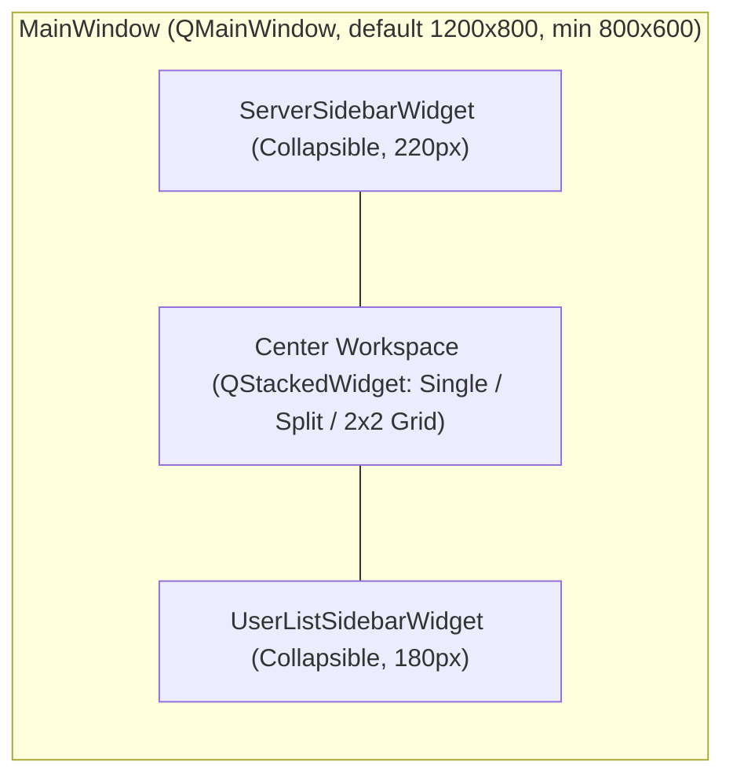

> Historical conversion plan/specification. Current implemented dependencies, connection contracts and verification are in ../README.md and reliability/README.md. Alternative libraries and old fixed-delay behavior below are not current runtime guarantees.

> Historical conversion design, not the current feature/verification contract. See [current README](../README.md) and [v2 migration notes](MIGRATION-v2.md).

# 04 — UI, UX, Themes, Audio & Utilities Specification

This specification documents the Qt 6 Widget hierarchy, custom theme engine, deterministic nickname coloring, mIRC format parsing, PCM audio synthesizer, Hunspell spell checker, and `/sysinfo` collector to ensure exact visual and behavioral parity with [`LoungeCat-Desktop`](https://github.com/binkiewka/LoungeCat-Desktop/tree/e0c82bf8f4358be8c48cfe3d39ffc6fa1a0a55f0).

---

## 1. Main Window Layout & Multi-Pane Architecture

Ported from [`DesktopMainScreen.kt`](https://github.com/binkiewka/LoungeCat-Desktop/blob/e0c82bf8f4358be8c48cfe3d39ffc6fa1a0a55f0/shared/src/desktopMain/kotlin/com/loungecat/irc/ui/screen/DesktopMainScreen.kt), ``SplitPane.kt`` (unpublished Kotlin working-copy reference), [`ChatGrid.kt`](https://github.com/binkiewka/LoungeCat-Desktop/blob/e0c82bf8f4358be8c48cfe3d39ffc6fa1a0a55f0/shared/src/desktopMain/kotlin/com/loungecat/irc/ui/components/ChatGrid.kt), and [`ChannelPane.kt`](https://github.com/binkiewka/LoungeCat-Desktop/blob/e0c82bf8f4358be8c48cfe3d39ffc6fa1a0a55f0/shared/src/desktopMain/kotlin/com/loungecat/irc/ui/components/ChannelPane.kt).



### 1.1 `ServerSidebarWidget` (Left Panel)
- **Top Action Bar**:
  - App Title / Logo (`LoungeCat`) + collapse toggle button (`<<` / `>>`).
  - Quick buttons: **Add Server** (`+`), **Grid Mode Selector** (`SINGLE`, `SPLIT_HORIZONTAL`, `SPLIT_VERTICAL`, `GRID_2X2`), **Settings**, **Export/Import Config**, **Help** (`?`).
- **Update Notification Banner**: Shown when `UpdateCheckService` detects a newer GitHub release; clicking opens the release URL.
- **Server & Channel Tree (`QTreeWidget` or custom `QTreeView`)**:
  - Top-level nodes: Each `ServerConnection` showing connection status dot (`green` = connected, `yellow` = connecting/reconnecting, `red` = error, `gray` = disconnected), server name, latency badge (`42ms`), and context menu (`Connect` / `Disconnect` / `Reconnect` / `Join Channel...` / `Edit Server` / `Delete Server`).
  - Child nodes:
    - `* <serverName>` (Server console tab, always first).
    - Joined `#channels` (with drag-and-drop internal reordering).
    - Private message / query tabs (`ChannelType::QUERY` / `PM`).
  - **Badges & Indicators**:
    - Unread count badge (`unreadCount > 0`): Pill badge in `unreadBadge` color (`#eb6f92` if `hasUnreadMention`, else `accentColor`).
    - Recent activity dot (`hasRecentActivity`): Subtle indicator if a message arrived within `preferences.activityIndicatorMinutes`.
    - Close (`×`) button on hover (parts channel or closes query tab).

### 1.2 `ChannelPaneWidget` (Center Chat View)
Each pane (1 in `SINGLE`, 2 in `SPLIT_*`, 4 in `GRID_2X2`) is an independent `ChannelPaneWidget`:
1. **Header Bar**:
   - In multi-pane mode: Channel selector `QComboBox` allowing any joined channel across any connected server to be pinned to that pane.
   - Channel name + user count + editable/clickable **Topic Bar** (elided single line, click to view/edit full topic).
   - Action icons: Search (`Ctrl+F`), Clear Chat, Export Chat (`.txt`/`.json`), Toggle User List.
2. **Search Overlay Bar (`SearchOverlayBar`)**:
   - Toggled via `Ctrl+F` or header search icon (`Esc` closes).
   - Live filters/highlights matching messages in the current channel with `Previous` / `Next` match navigation and match count (`3 of 14`).
3. **Virtualized Message View (`MessageListView` + `MessageListModel` + `MessageItemDelegate`)**:
   - Custom `QAbstractListModel` exposing `ChatViewItem` rows (`IncomingMessage` or collapsible `JoinPartGroup`).
   - Custom `QStyledItemDelegate` using cached `QTextDocument` instances per row width for zero-jank scrolling:
     - Draws `[timestamp]` (formatted per `TimestampFormat`: `HH:mm`, `hh:mm a`, or relative `now`/`5m`/`2h`/`MM/dd` in configured `QTimeZone`), `<sender>` (colored via `NickColorGenerator`), and formatted message body (`IrcFormatParser`).
     - Highlights mention rows (`isHighlight` or `HighlightMatcher::containsHighlight`) with translucent `highlightBackground` fill and left accent border.
     - Renders inline `UrlPreviewCardWidget` (OpenGraph title/description/siteName and async-loaded image thumbnail with click-to-open and collapse toggle) when `urlImageDisplayMode != DISABLED`.
   - **Multi-Message Selection**: Supports dragging across multiple rows to select text and copying via `Ctrl+C` (matching `SelectionController.kt`).
   - **Scroll-to-Bottom Floating Button**: Appears when scrolled up from the bottom, showing unread message count arrived while scrolled up.
4. **Reply Banner & Input Area (`ChatInputWidget`)**:
   - Optional Reply Banner above input when replying to a specific message (`Replying to <nick>: ...` with `×` cancel).
   - Formatting Toolbar strip: Bold (`Ctrl+B` inserts `\x02`), Italic (`Ctrl+I` inserts `\x1D`), Underline (`Ctrl+U` inserts `\x1F`), Strikethrough (`\x1E`), Color picker (`\x03`), Reset (`\x0F`), Upload Image button (`ImgBbService`).
   - Custom `QPlainTextEdit` / `QTextEdit` subclass:
     - `Enter` sends message; `Shift+Enter` inserts newline.
     - `Up` / `Down` arrows cycle per-channel sent command/message history.
     - `Tab` / `Shift+Tab` invokes `TabCompletion` (cycling `/commands`, `#channels`, and `@nicknames`).
     - `Ctrl+M` invokes `SpellChecker::applyCorrections()` to replace all misspelled words in the input box at once.
     - Red wavy underline (`QTextCharFormat::SpellCheckUnderline`) via `QSyntaxHighlighter` powered by `SpellChecker`, with right-click context menu offering top 5 Hunspell suggestions.

### 1.3 `UserListSidebarWidget` (Right Panel)
- Displays users in the active channel grouped by role (`Owners ~`, `Admins &`, `Operators @`, `Half-Ops %`, `Voiced +`, `Users`) or in a unified sorted list with count header (`Users (42)`) and filter search box.
- **Hover Tooltip (Silent WHOIS)**:
  - Hovering over a user row checks `client->getCachedWhois(nickname)`. If missing or older than 60 seconds, triggers `client->startSilentWhois(nickname)` and displays `WhoisInfo::toTooltipString()` once received.
- **Right-Click Context Menu**:
  - `Private Message (Query)`, `WHOIS`, `Mention (@nick)`, `Ignore / Unignore`, `Slap!`, and **Moderation submenu** (`Op`, `Deop`, `Voice`, `Devoice`, `Kick...`, `Ban...`, `Kickban...`, `Moderation Dialog...`).

---

## 2. Theme Engine & Palettes (`Theme.h`, `ThemeManager.h`)

Ported from [`Theme.kt`](https://github.com/binkiewka/LoungeCat-Desktop/blob/e0c82bf8f4358be8c48cfe3d39ffc6fa1a0a55f0/shared/src/commonMain/kotlin/com/loungecat/irc/ui/theme/Theme.kt) and [`ThemeManager.kt`](https://github.com/binkiewka/LoungeCat-Desktop/blob/e0c82bf8f4358be8c48cfe3d39ffc6fa1a0a55f0/shared/src/desktopMain/kotlin/com/loungecat/irc/ui/theme/ThemeManager.kt).

### 2.1 `ThemeColors` Struct (22 Semantic Colors + `isDark`)

| Field / JSON Key | Built-in `DARK` Default | Built-in `LIGHT` Default |
|---|---|---|
| `windowBackground` | `#191724` | `#faf4ed` |
| `currentLineBackground` | `#26233a` | `#f2e9e1` |
| `selectionBackground` | `#403d52` | `#dfdad9` |
| `foreground` | `#e0def4` | `#575279` |
| `comment` | `#908caa` | `#797593` |
| `cyan` | `#9ccfd8` | `#56949f` |
| `green` | `#31748f` | `#286983` |
| `orange` | `#ebbcba` | `#d7827e` |
| `pink` | `#c4a7e7` | `#907aa9` |
| `purple` | `#c4a7e7` | `#907aa9` |
| `red` | `#eb6f92` | `#b4637a` |
| `yellow` | `#f6c177` | `#ea9d34` |
| `border` | `#26233a` | `#dfdad9` |
| `chatBackground` | `#1f1d2e` | `#fffaf3` |
| `inputBackground` | `#191724` | `#f2e9e1` |
| `sidebarBackground` | `#191724` | `#f2e9e1` |
| `timestampColor` | `#6e6a86` | `#9893a5` |
| `systemMessageColor` | `#908caa` | `#797593` |
| `actionMessageColor` | `#c4a7e7` | `#907aa9` |
| `highlightBackground` | `#33ebbcba` | `#33d7827e` |
| `unreadBadge` | `#eb6f92` | `#b4637a` |
| `accentColor` | `#c4a7e7` | `#907aa9` |

### 2.2 All 6 Built-In Themes
1. **`Dark`** (Rose Pine Dark — default)
2. **`Light`** (Rose Pine Dawn)
3. **`High Voltage`** (`windowBackground = #0D0E15`, `chatBackground = #131520`, `accentColor = #00FF9F`, `yellow = #FFE600`)
4. **`Neon Night`** (`windowBackground = #090514`, `chatBackground = #110926`, `accentColor = #FF2A85`, `cyan = #05D5FF`)
5. **`Retro Warmth`** (Gruvbox Dark — `windowBackground = #1d2021`, `chatBackground = #282828`, `foreground = #ebdbb2`, `accentColor = #d79921`)
6. **`Stormy Sea`** (Nord — `windowBackground = #242933`, `chatBackground = #2E3440`, `foreground = #ECEFF4`, `accentColor = #88C0D0`)

### 2.3 Custom JSON Themes (`~/.loungecat/themes/*.json`)
- On startup, `ThemeManager` writes `_theme_template.json.example` if missing and loads all `*.json` files whose filename does **not** start with `_`.
- Missing color keys in a custom JSON theme fall back to either `DARK` or `LIGHT` defaults depending on `"isDark": true/false`.

---

## 3. Deterministic Nickname Coloring (`NickColorGenerator`)

Ported from [`NickColorGenerator.kt`](https://github.com/binkiewka/LoungeCat-Desktop/blob/e0c82bf8f4358be8c48cfe3d39ffc6fa1a0a55f0/shared/src/commonMain/kotlin/com/loungecat/irc/util/NickColorGenerator.kt).

> [!IMPORTANT]
> To ensure every user gets the exact same nickname color in C++ as in Kotlin, C++ must compute Java's `String.hashCode()` over UTF-16 code units (`QString::utf16()`):
> ```cpp
> int32_t javaStringHashCode(const QString& str) {
>     uint32_t h = 0;
>     for (QChar ch : str) {
>         h = 31u * h + static_cast<uint32_t>(ch.unicode());
>     }
>     return static_cast<int32_t>(h);
> }
> size_t index = static_cast<size_t>( std::abs(static_cast<int64_t>(javaStringHashCode(nickname))) % 16 );
> ```

### 3.1 Dark Theme 16-Color Palette (`isDark == true`)
`#FF6B6B`, `#4ECDC4`, `#FFE66D`, `#95E1D3`, `#F38181`, `#AA96DA`, `#FCBAD3`, `#A8D8EA`, `#FF9F43`, `#EE5A24`, `#009432`, `#0652DD`, `#9980FA`, `#833471`, `#EA2027`, `#006266`

### 3.2 Light Theme 16-Color Palette (`isDark == false`)
`#D63031`, `#00B894`, `#0984E3`, `#6C5CE7`, `#E17055`, `#00CEC9`, `#FD79A8`, `#E84393`, `#2D3436`, `#636E72`, `#B2BEC3`, `#74B9FF`, `#A29BFE`, `#55EFC4`, `#81ECEC`, `#FAB1A0`

---

## 4. mIRC Control Code Formatting (`IrcFormatParser`)

Ported from [`IrcFormatParser.kt`](https://github.com/binkiewka/LoungeCat-Desktop/blob/e0c82bf8f4358be8c48cfe3d39ffc6fa1a0a55f0/shared/src/commonMain/kotlin/com/loungecat/irc/util/IrcFormatParser.kt):
- Control bytes:
  - `0x02`: Toggle Bold
  - `0x1D`: Toggle Italic
  - `0x1F`: Toggle Underline
  - `0x1E`: Toggle Strikethrough
  - `0x16`: Toggle Reverse (swap foreground and background colors)
  - `0x0F`: Reset all formatting to defaults
  - `0x03`: Color code `^C[fg[,bg]]` where `fg` and `bg` are 1–2 digit integers (`00`–`99`). Bare `0x03` resets colors.
- Standard 16 mIRC Colors (`0`–`15`):
  - `0`: `#FFFFFF`, `1`: `#000000`, `2`: `#00007F`, `3`: `#009300`, `4`: `#FF0000`, `5`: `#7F0000`, `6`: `#9C009C`, `7`: `#FC7F00`, `8`: `#FFFF00`, `9`: `#00FC00`, `10`: `#009393`, `11`: `#00FFFF`, `12`: `#0000FC`, `13`: `#FF00FF`, `14`: `#7F7F7F`, `15`: `#D2D2D2`.

---

## 5. Synthesized Audio Alerts (`SoundService`)

Ported from [`SoundService.kt`](https://github.com/binkiewka/LoungeCat-Desktop/blob/e0c82bf8f4358be8c48cfe3d39ffc6fa1a0a55f0/shared/src/desktopMain/kotlin/com/loungecat/irc/service/SoundService.kt).

### 5.1 Tone Parameters (44,100 Hz, 16-bit Signed Mono PCM)
| `SoundType` | Frequency (Hz) | Duration (ms) | Trigger Condition |
|---|---|---|---|
| `MENTION` | `880.0` (A5) | `150` | `soundAlertsEnabled && soundOnMention` |
| `PRIVATE_MESSAGE` | `660.0` (E5) | `200` | `soundAlertsEnabled && soundOnPrivateMessage` |
| `HIGHLIGHT` | `1046.5` (C6) | `100` | `soundAlertsEnabled && soundOnHighlight` |
| `CONNECT` | `523.25` (C5) | `300` | `soundAlertsEnabled` |
| `DISCONNECT` | `392.0` (G4) | `400` | `soundAlertsEnabled` |

### 5.2 Envelope Formula
For sample $i \in [0, N)$ where $N = \lfloor 44100 \times \frac{\text{durationMs}}{1000} \rfloor$ and $\text{fadeSamples} = \lfloor 0.10 \times N \rfloor$:
$$\text{envelope}(i) = \begin{cases} \frac{i}{\text{fadeSamples}} & \text{if } i < \text{fadeSamples} \\ \frac{N - i}{\text{fadeSamples}} & \text{if } i > N - \text{fadeSamples} \\ 1.0 & \text{otherwise} \end{cases}$$
$$\text{sample}(i) = \text{ round}\!\left(\sin\!\left(2\pi \cdot f \cdot \frac{i}{44100}\right) \times 32767 \times \text{clamp}(\text{volume}, 0, 1) \times \text{envelope}(i)\right)$$
- **Linux Playback**: Play via ALSA `snd_pcm_open("default", ...)` (if `HAVE_ALSA`) or write an in-memory RIFF WAVE buffer to `aplay -q -` via `QProcess` so audio works out-of-the-box without requiring extra Qt Multimedia plugins.

---

## 6. `/sysinfo` Collector (`SystemInfoCollector`)

Ported from [`SystemInfoCollector.kt`](https://github.com/binkiewka/LoungeCat-Desktop/blob/e0c82bf8f4358be8c48cfe3d39ffc6fa1a0a55f0/shared/src/desktopMain/kotlin/com/loungecat/irc/util/SystemInfoCollector.kt):
- Output format:
  `Client: LoungeCat <version> • OS: <os> • CPU: <cpu> • Memory: <total> GiB Total (<free> GiB Free) • Storage: <used> GiB / <total> GiB (<free> GiB Free) • VGA: <gpu> • Uptime: <d>d <h>h <m>m <s>s`
- Linux sources:
  - **OS**: `/etc/os-release` `PRETTY_NAME` + `QSysInfo::kernelVersion()` + `QSysInfo::currentCpuArchitecture()`.
  - **CPU**: `/proc/cpuinfo` `model name`.
  - **Memory**: `/proc/meminfo` `MemTotal` and `MemAvailable`.
  - **Storage**: Deduplicated physical block devices from `/proc/mounts` (`/dev/sd*`, `/dev/nvme*`, `/dev/vd*`, `/dev/mapper/*`, `zfs`, `btrfs`) queried via `QStorageInfo` / `statvfs`.
  - **VGA**: Output of `lspci` filtered for `VGA compatible controller` or `3D controller`.
  - **Uptime**: `/proc/uptime` first float parsed into days, hours, minutes, seconds.
