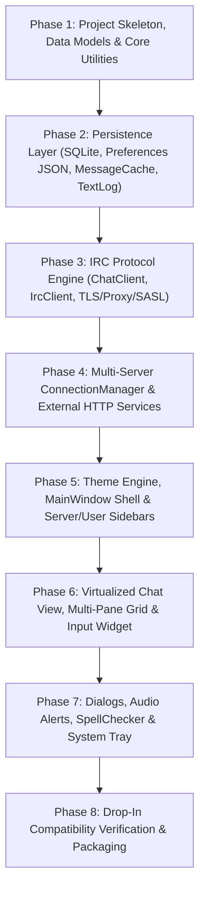

> Historical conversion plan/specification. Current implemented dependencies, connection contracts and verification are in ../README.md and reliability/README.md. Alternative libraries and old fixed-delay behavior below are not current runtime guarantees.

> Historical conversion design, not the current feature/verification contract. See [current README](../README.md) and [v2 migration notes](MIGRATION-v2.md).

# 05 — Step-by-Step Conversion & Verification Plan

This document provides the actionable, phased roadmap for implementing the native C++20 / Qt 6 port of LoungeCat in the repository root. Each phase produces a compilable, testable milestone with explicit verification criteria.

---

## Phase Overview

---

## Phase 1: Project Skeleton, Data Models & Pure Utilities

### Goal
Bootstrap the CMake build system, define all domain structs/enums, and port all stateless/pure-logic utility classes with unit tests.

### Files to Create
1. `CMakeLists.txt` and `tests/CMakeLists.txt`
2. `src/data/model/ServerConfig.h/.cpp`
3. `src/data/model/IncomingMessage.h/.cpp`
4. `src/data/model/Channel.h/.cpp`
5. `src/data/model/ChannelUser.h/.cpp`
6. `src/data/model/UserPreferences.h/.cpp`
7. `src/data/model/ServerConnection.h/.cpp`
8. `src/data/model/UrlPreview.h/.cpp`
9. `src/data/model/WhoisInfo.h/.cpp`
10. `src/util/PlatformUtils.h/.cpp`
11. `src/util/IrcFormatParser.h/.cpp`
12. `src/util/IrcCommandParser.h/.cpp`
13. `src/util/NickColorGenerator.h/.cpp`
14. `src/util/HighlightMatcher.h/.cpp`
15. `src/util/ChatGrouping.h/.cpp`
16. `src/util/TabCompletion.h/.cpp`

### Verification & Unit Tests (`Qt6::Test`)
- [ ] `test_irc_format_parser`: Verify bold (`0x02`), italic (`0x1D`), underline (`0x1F`), strikethrough (`0x1E`), reverse (`0x16`), reset (`0x0F`), and `0x03` foreground/background color codes (`03,04`, bare `0x03`, out-of-range numbers), plus `stripFormatting()`.
- [ ] `test_irc_command_parser`: Verify all 45+ slash commands and aliases (`/j`, `/msg`, `/whois`, `/kb`, `/ns`, `/slap`, `/shrug`, `/sysinfo`, `/uploadimage`, etc.) parse into the expected `IrcCommand` variant types.
- [ ] `test_nick_color_generator`: Verify `javaStringHashCode("binkiewka")` and resulting palette index match Kotlin's `"binkiewka".hashCode()` modulo 16 in both dark and light mode.
- [ ] `test_highlight_matcher`: Verify word-boundary matching (`\bnick\b`), punctuation adjacency (`"nick:"`, `"@nick"`), and non-matching substrings (`"nickname"`).
- [ ] `test_chat_grouping`: Verify `SHOW_ALL`, `HIDE_ALL`, `GROUPED` (consecutive join/part/quit collapsed into `JoinPartGroup`), and `SMART_HIDE` (filtering out users inactive beyond `smartHideMinutes`).
- [ ] `test_tab_completion`: Verify cycling through `/commands`, `#channels`, and `@nicknames` with `: ` suffix at index 0 and `' '` suffix mid-sentence.

---

## Phase 2: Persistence Layer (`~/.loungecat/` Drop-In Compatibility)

### Goal
Implement SQLite server storage, `preferences.json` management, debounced `MessageCache` JSON files, plaintext `.log` writer, and backup/chat exporters.

### Files to Create
1. `src/app/AppConfig.h/.cpp`
2. `src/app/SingleInstanceGuard.h/.cpp`
3. `src/data/database/DatabaseService.h/.cpp`
4. `src/data/preferences/PreferencesManager.h/.cpp`
5. `src/data/cache/MessageCache.h/.cpp`
6. `src/service/TextLogService.h/.cpp`
7. `src/util/ChatExporter.h/.cpp`
8. `src/util/ConfigExporter.h/.cpp`

### Verification & Unit Tests
- [ ] `test_database_service`:
  - Open an existing `loungecat.db` created by Kotlin, verify `getAllServerConfigs()` reads all 24 columns accurately.
  - Test auto-migration on an older `server_configs` table missing `proxy_type` and `alt_nickname`.
  - Test `insertServerConfig`, `updateServerConfig`, and `deleteServerConfig`.
- [ ] `test_preferences_manager`:
  - Load a real `preferences.json` from `~/.loungecat/preferences.json`, verify all 34 properties match, modify a field, save, and verify JSON structure matches Kotlin's `kotlinx.serialization` output.
- [ ] `test_message_cache`:
  - Verify `safeName` sanitization (`#c++` -> `#c__`), 2000-message disk cap, exclusion of `JOIN`/`PART`/`QUIT`/`MOTD`, and cross-channel search.
- [ ] `test_text_log_service`:
  - Verify `[yyyy-MM-dd HH:mm:ss] <sender> content` formatting and legacy `ServerName_` folder migration.

---

## Phase 3: IRC Protocol Engine (`ChatClient` & `IrcClient`)

### Goal
Implement the asynchronous IRCv3 / RFC 1459 client using `QSslSocket` and `QNetworkProxy`.

### Files to Create
1. `src/network/ChatClient.h/.cpp`
2. `src/network/IrcClient.h/.cpp`

### Key Implementation Steps
1. Wire `QSslSocket` with UTF-8 line buffering (`\r\n` and `\n` framing, handling partial reads cleanly).
2. Configure `QNetworkProxy` (`NoProxy`, `Socks5Proxy`, `HttpProxy`) on the socket before `connectToHost()` / `connectToHostEncrypted()`.
3. Implement SHA-256 certificate fingerprint verification and Trust-On-First-Use (TOFU) callback hook.
4. Implement RFC 1459 line parser (`:prefix COMMAND params :trailing`).
5. Implement `CAP LS 302` -> `CAP REQ :sasl` -> `AUTHENTICATE PLAIN` -> `903` -> `CAP END` state machine.
6. Implement all numeric handlers (`001`–`005`, `250`–`266`, `301`–`379`, `400`–`599`, `671`), CTCP `ACTION`/`VERSION`, channel user mode prefix tracking (`~&@%+`), and silent/active WHOIS cache.
7. Implement 30-second keepalive `PING :keepalive` and `PONG` latency calculation.

### Verification & Unit Tests
- [ ] `test_irc_client`: Use a local mock `QTcpServer` in Qt Test to simulate:
  - SASL `PLAIN` negotiation (`CAP LS`, `AUTHENTICATE +`, `903`).
  - Welcome `001` triggering NickServ identify, delayed on-connect commands, and auto-join channels.
  - `433` Nickname in use triggering fallback to `altNickname` and `_` suffix.
  - `353` / `366` `NAMES` parsing with `@`, `+`, `~` prefixes and `MODE +o/-o` updates.
  - `311`–`318` `WHOIS` aggregation and silent WHOIS suppression.

---

## Phase 4: Multi-Server `ConnectionManager` & External HTTP Services

### Goal
Implement the central state coordinator (`ConnectionManager`) and all HTTP-backed services (`LinkPreviewService`, `PastebinService`, `ImgBbService`, `UrlShortenerService`, `UpdateCheckService`).

### Files to Create
1. `src/network/ConnectionManager.h/.cpp`
2. `src/service/LinkPreviewService.h/.cpp`
3. `src/service/PastebinService.h/.cpp`
4. `src/service/ImgBbService.h/.cpp`
5. `src/service/UrlShortenerService.h/.cpp`
6. `src/service/UpdateCheckService.h/.cpp`
7. `src/util/SystemInfoCollector.h/.cpp`

### Verification & Unit Tests
- [ ] Verify exponential backoff reconnect schedule (`5s`, `15s`, `30s`, `60s`, `300s`) and 120-second stability reset.
- [ ] Verify `LinkPreviewService` regex extraction, 64 KB HTML truncation, OpenGraph meta parsing, YouTube oEmbed parsing, and concurrency limit of 3.
- [ ] Verify outgoing message pipeline: URL shortening when URL length `>= 200` and Pastebin upload when message exceeds `400` chars or `5` lines.

---

## Phase 5: Theme Engine, `MainWindow` Shell & Sidebars

### Goal
Build the application theming system (`ThemeManager`), main window layout (`MainWindow`), left server/channel tree (`ServerSidebarWidget`), and right channel user list (`UserListSidebarWidget`).

### Files to Create
1. `src/ui/theme/Theme.h/.cpp`
2. `src/ui/theme/ThemeManager.h/.cpp`
3. `src/ui/window/MainWindow.h/.cpp`
4. `src/ui/sidebar/ServerSidebarWidget.h/.cpp`
5. `src/ui/sidebar/UserListSidebarWidget.h/.cpp`

### Verification Criteria
- [ ] Switching between all 6 built-in themes (`Dark`, `Light`, `High Voltage`, `Neon Night`, `Retro Warmth`, `Stormy Sea`) and custom `~/.loungecat/themes/*.json` files dynamically re-styles all widgets without restarting.
- [ ] Left sidebar displays servers, connection states, latency, unread/mention badges, and supports drag-and-drop channel reordering.
- [ ] Right sidebar groups/sorts users by mode (`~`, `&`, `@`, `%`, `+`, normal), filters by search text, and shows cached/silent WHOIS tooltips on hover.

---

## Phase 6: Virtualized Chat View, Multi-Pane Grid & Input Widget

### Goal
Build the high-performance chat message list (`MessageListModel`, `MessageListView`, `MessageItemDelegate`), inline URL/image preview cards, multi-pane split/grid containers, and rich chat input box.

### Files to Create
1. `src/ui/chat/SplitViewContainer.h/.cpp`
2. `src/ui/chat/ChatGridContainer.h/.cpp`
3. `src/ui/chat/ChannelPaneWidget.h/.cpp`
4. `src/ui/chat/MessageListModel.h/.cpp`
5. `src/ui/chat/MessageListView.h/.cpp`
6. `src/ui/chat/MessageItemDelegate.h/.cpp`
7. `src/ui/chat/UrlPreviewCardWidget.h/.cpp`
8. `src/ui/chat/ChatInputWidget.h/.cpp`
9. `src/ui/chat/SearchOverlayBar.h/.cpp`

### Verification Criteria
- [ ] Smooth 60+ FPS scrolling with 2,000+ messages in a channel including mIRC colors, clickable links, clickable nicknames, and collapsible `JoinPartGroup` rows.
- [ ] Multi-message text selection and `Ctrl+C` copy work cleanly across rows.
- [ ] Switching between `SINGLE`, `SPLIT_HORIZONTAL`, `SPLIT_VERTICAL`, and `GRID_2X2` preserves per-pane channel selections and scroll positions.
- [ ] `Ctrl+F` search bar highlights matches and jumps between occurrences.

---

## Phase 7: Dialogs, Audio Synthesizer, SpellChecker & System Tray

### Goal
Complete all dialogs, PCM sine-wave sound alerts, Hunspell spell checking, and system tray integration.

### Files to Create
1. `src/service/SoundService.h/.cpp`
2. `src/util/SpellChecker.h/.cpp`
3. `src/ui/dialog/ConnectServerDialog.h/.cpp`
4. `src/ui/dialog/SettingsDialog.h/.cpp`
5. `src/ui/dialog/ModerationDialog.h/.cpp`
6. `src/ui/dialog/ChannelListDialog.h/.cpp`
7. `src/ui/dialog/ThemeEditorDialog.h/.cpp`
8. `src/ui/dialog/HelpDialog.h/.cpp`
9. `src/ui/tray/SystemTrayController.h/.cpp`
10. `src/main.cpp`

### Verification Criteria
- [ ] `SoundService` plays `MENTION` (880 Hz), `PRIVATE_MESSAGE` (660 Hz), `HIGHLIGHT` (1046.5 Hz), `CONNECT` (523.25 Hz), and `DISCONNECT` (392 Hz) with volume control and test buttons in `SettingsDialog`.
- [ ] `SpellChecker` underlines typos in `en_US`, `de`, `nl`, and `pl`, ignores IRC commands/slang (`lol`, `brb`, `afk`), offers right-click suggestions, and fixes all typos on `Ctrl+M`.
- [ ] `ConnectServerDialog` edits all 24 `ServerConfig` properties (General, Auth/SASL, Auto-Join/Commands, TLS Pinning/TOFU, Proxy).
- [ ] `ModerationDialog` executes Kick, Ban, Kickban, and Quiet with hostmask selection.
- [ ] `SystemTrayController` minimizes/restores window on tray click and displays desktop notifications on mentions/PMs/highlights (skipped when `HEADLESS=true`).

---

## Phase 8: End-to-End Drop-In Migration Test & Packaging

### Goal
Validate that a live `~/.loungecat/` directory from the Kotlin desktop app works seamlessly with the C++ binary and package the release build.

### Verification Checklist
- [ ] Launch `./build/loungecat` against an existing `~/.loungecat/` folder:
  - Verify all saved servers in `loungecat.db` auto-connect.
  - Verify `preferences.json` settings and custom themes load without data loss.
  - Verify cached messages in `~/.loungecat/cache/messages/*.json` replay into channels on join.
  - Verify `~/.loungecat/logs/<Server>/<Channel>.log` appends seamlessly.
- [ ] Verify memory footprint (target `< 60 MB` RSS idle vs. ~350–600 MB JVM heap in Kotlin) and startup time (`< 150 ms`).
- [ ] Configure CPack / AppImage / `.deb` targets in `CMakeLists.txt`.
